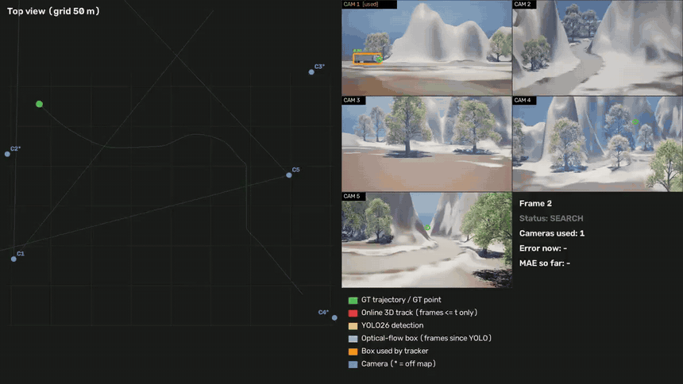
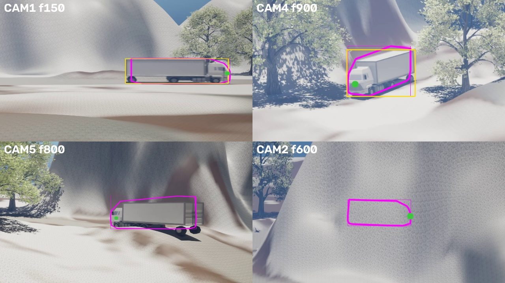

# Peleng — where is the truck: online 3D tracking from five cameras

Hackathon task from Peleng: find the real-world 3D position of a moving truck using five fixed cameras with known calibration. The answer must be produced **online** — every frame is processed using only the current and past frames, as a real system would work.



**Pipeline:** YOLO detection and SAM 2 masks in each camera → rays from calibrated cameras → multi-camera triangulation and fitting of the truck's metric CAD model → Kalman filtering of the trajectory → speed and position for every frame. A web player replays the result next to the video.



**Result on the Way1 sequence:** MAE 2.46 m over 999 frames, coordinates on every frame, error under 1 m on 282 frames.

**My part in the team:**
- **Cab ray** (`--cab-ray`): position from a single camera before the first multi-camera fix — MAE on the first 20 frames dropped from 5.03 m to 1.74 m
- **Gap filling** (`online/estimation/gap_fill.py`, v1–v5): an answer on every frame when the tracker loses the truck (dust, occlusions) — prediction, SAM 2 masks, Kalman filter on the output point
- Input parser for the Way2 data, metrics without ground truth, detector fine-tuning
- Demo video: top view + five cameras with detections

**Stack:** Python, NumPy, OpenCV, PyTorch, YOLO, SAM 2, Kalman filters, multi-view geometry

---

# Пеленг — причинное сопровождение CAD по нескольким камерам

Программа оценивает положение и ориентацию заданной метрической CAD-модели. Основной поток выдаёт координаты кадра сразу после его обработки. Отдельная оранжевая траектория поддерживает настраиваемый фиксированный лаг.

## Структура

| Путь | Назначение |
| --- | --- |
| `online/perception/` | Сегментация, PicoPose, GoTrack, RoMa, TAPNext и рендеринг |
| `online/estimation/` | Геометрические измерения, состояние и причинные поправки |
| `online/evaluation/` | Оценка метрик, сравнение и графики |
| `online/pipeline.py` | Объединение измерений подключённых моделей |
| `online/tracker.py` | Управление наблюдениями камер |
| `online/run.py` | Покадровый запуск |
| `core/` | Камеры, системы координат и чтение данных |
| `web/` | Веб-плеер и настройки сглаживания |
| `tools/` | Запуск, загрузка ресурсов и генерация проверочных сцен |
| `tests/` | Проверки соглашений координат и совместимости |
| `experiments/` | Исторические экспериментальные реализации |
| `docs/` | Инструкции и устройство проекта |

Прежние команды `python -m online.run`, `online.evaluate`, `online.compare` продолжают работать. Прежние пути импорта перенаправляются на соответствующие пакеты.

## Запуск на Linux

```bash
python tools/run_online.py --runtime configs/linux-runtime.json   --data /path/to/data --out /path/to/results   --sam models/sam2/sam2.1_hiera_tiny
python -m online.evaluate --out /path/to/results --reference /path/to/reference.csv
```

Файл runtime задаёт каталоги дополнительных библиотек и кэша на Linux. Каталоги данных, весов и результатов хранятся отдельно от исходников.

Полная инструкция находится в [docs/online.md](docs/online.md). Новые оценщики описаны в [docs/modernization.md](docs/modernization.md), проверенные метрики — в [docs/results.md](docs/results.md). История исходного решения сохранена в [docs/legacy-overview.md](docs/legacy-overview.md).
